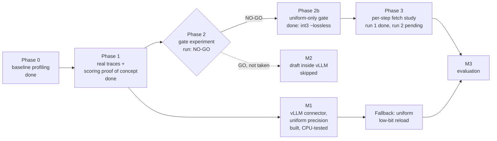

# 4. Phases

Each phase answers one question and decides what the next phase builds.

---

## Phase 0

**Question:** does a plain, unoptimized KV cache really become a problem under an agent-like
workload?

**What was done.** [`src/baseline_experiment.py`](../src/baseline_experiment.py) loads
Llama-3.2-1B-Instruct with Hugging Face `transformers` and no KV optimizations. It then simulates
an agent: each turn appends a real tool output to the context, keeps the KV cache, and generates
64 tokens.

| Run | Data | Turns | Final context |
|---|---|---|---|
| SWE-bench (django-10554) | tool outputs from one real coding-agent run | 126 | 35,293 tokens |
| SWE-bench (sympy-14248) | tool outputs from one real coding-agent run | 108 | 34,993 tokens |
| ALFWorld | 36 household-task games joined together | 514 | 48,030 tokens |
| Synthetic | filler text (smoke test only) | 500 | 144,000 tokens |

**Findings**
- GPU memory in use grows linearly with context: 2.3 GB of weights to 3.4 GB at 35k tokens.
- PyTorch *reserves* far more than it uses. On ALFWorld it reserved 19.1 GB for 3.8 GB in use.
  The fragmentation comes from temporary attention buffers.
- Decoding slows as context grows: 124 to 74 tokens/s at 144k (synthetic).

**Limitations.** The context held only tool outputs, not the task or the agent's real messages,
and the KV size was not measured directly. Phase 1 fixed both.

**Code and results:** [`src/`](../src/), [`data/`](../data/), [`results/`](../results/).

---

## Phase 1

**Questions:** (1) how do memory and speed behave with the full, real agent conversation?
(2) Can draft guesses identify the tokens that matter, and is quantizing better than evicting?

**Setup:** Google Colab T4 GPU, `unsloth/Llama-3.2-1B-Instruct` in fp16. Data: 10 real
mini-SWE-agent runs on SWE-bench Verified, the longest run from each of 10 projects, 18k–56k
tokens (see [Benchmarks](05-benchmarks.md#workload-real-agent-recordings)).

**Experiment 1: full-conversation replay.** Each run is replayed turn by turn with the system
prompt, task, the agent's real messages and the real tool outputs.
- The KV cache is exactly **32 KB/token** on every turn of every run (1.71 GB at 56k).
- Decoding slows from about **42 to 3.3 tokens/s** at 56k, about 13×. Reading 1,000 new tokens
  costs about 200 ms early on and about 1,400–1,500 ms at 40k–55k.
- About 14 GB is reserved for about 4 GB in use.
- The Phase 0 method undercounts real context by about 12%.

**Experiment 2: consensus scoring proof of concept.** Three runs were cut at about 2k–5k tokens,
giving 12 contexts, each just before a real agent message. Each method chose the top 5/10/20/40%
of tokens. The rest were either quantized to 2-bit or evicted, and the damage to the real next
message was measured. The draft was the same 1B model as the target.

| Result | Number |
|---|---|
| Share of the truly needed tokens found (top 10%) | consensus N=4: **52%**; SnapKV-style (look back): 32%; random: 10% |
| Damage, keep 10%: quantize vs. evict (consensus N=4) | +0.043 vs. +0.317 ΔNLL (**7×** less) |
| Damage, keep 20% | +0.007 vs. +0.123 (**18×** less) |
| Everything at 2-bit, nothing kept | +0.054 ΔNLL |
| More guesses (N=1 to 8) | Helps under eviction, little effect under quantization |
| Where the important tokens are | The agent's own recent messages: 40–42% of the top 10%, though only 8–19% of the context |

**What it changed:** quantizing beats evicting (keep every token), and lookahead scoring works.
But uniform 2-bit is already cheap, so a draft must earn its cost. That led to the gate and to the
v2 design ([The idea](02-idea.md#how-the-idea-evolved)).

**Code and results:** [`Phase_1/`](../Phase_1/). Its README has every graph explained.

---

## Phase 2: gate experiment

**Question:** at equal reload bytes, does draft-guided precision beat uniform 4-bit, with the
real 8B target and 1B draft? This is RQ1 and RQ2 in [Goals](03-goals.md).

**What it does:** it replays 31 tool-call pauses (histories of 8k–34k tokens) offline in
`transformers`. For each pause it reloads the history at every precision scheme, reads the tool
output on top, and measures the damage to the real next agent message against the bytes. The
decision rule is fixed in code before any run. Full protocol:
[Benchmarks](05-benchmarks.md#benchmark-1-gate-experiment-offline).

**Status: run, NO-GO.** One A40 48 GB, 31 pauses, about 40 minutes.

| Result | Number |
|---|---|
| Uniform int4 (block 16) | ΔNLL **+0.0009** at 0.325 of the bf16 bytes, top-1 agreement 0.991 |
| Uniform int2 (block 16) | ΔNLL +0.0332 at 0.200 |
| Best draft-guided configuration | fails both parts of the rule; part (a) by ~10×, part (b) narrowly (top 40% at int4: 0.250 bytes vs. the 0.244 limit, CI upper bound +0.011 vs. +0.01) |
| Oracle (target's own attention) | never beats uniform int4 (every paired CI above 0) |
| Consensus vs. SpecPrefill scoring | statistically tied (every paired CI includes 0); both beat recency and random |
| Draft scoring latency (A40, HF eager, median) | draft_window 81 ms, SpecPrefill 246 ms, consensus 701 ms |

**What it changed:** uniform 4-bit is almost lossless for the 8B target, and any scheme that puts most
blocks at int2 pays more than int4 costs everywhere. The limit is the 2-bit floor, not the scorer.
M2 (the draft inside vLLM) is skipped.

**Code:** [`kv_manager/experiments/gate/`](../kv_manager/experiments/gate/).
**Results:** [`kv_manager/results/gate/`](../kv_manager/results/gate/) (REPORT.md, summary.md).

---

## Phase 2b: uniform-only gate

**Question:** how much does uniform low-bit reload cost, including 3-bit, and does it depend on the model?

**What it does:** `run_gate.py --uniform-only` runs uniform int4, int3 and int2 plus a bf16 control (no draft)
on the same 31 pauses, for Llama-3.1-8B, Llama-3.2-3B and Qwen3-8B. int3 uses the same quantization
arithmetic without bit packing. Qwen3 drops 4 pauses that exceed its 32,768-token context.

| Model (block 16) | int4 | int3 | int2 |
|---|---|---|---|
| Llama-3.1-8B | +0.0009 (0.325) | **−0.0001 (0.262)** | +0.0332 (0.200) |
| Llama-3.2-3B | +0.0006 | +0.0055 | +0.0347 |
| Qwen3-8B (27 pauses) | −0.0061 | −0.0036 | −0.0134 |

**Findings:** uniform int3 is effectively lossless on Llama-8B, and at about the same bytes it beats the
gate's consensus and SpecPrefill rows (for example −0.013 nats against consensus with the top 5% at bf16).
Qwen3's negative ΔNLLs under added noise are suspicious: the recorded agent messages (written by another
model) are probably unusual text for Qwen, so its numbers are not comparable with Llama's yet.

**Results:** [`kv_manager/results/gate_uniform/`](../kv_manager/results/gate_uniform/).

---

## Phase 3: per-step fetch study

**Question:** instead of choosing precision once at reload, can a 2-bit (or 1-bit) history plus a small set of
bf16 tokens fetched at every decoding step (as in SpeCache) beat uniform low-bit reload?

**What it does:** `run_fetch.py` reloads the history at the base precision (block 0, the last 64 tokens and the
partial tail block in bf16), prefills the tool output over it, then teacher-forces the first ≤64 tokens of the
real next message one at a time. At every step and layer each scheme swaps its own top-k history tokens per
KV head to bf16 for that step only. All schemes run as one batch on the same pause; a noise-floor control
(identical to bf16 in exact arithmetic) measures bf16 rounding.

**Run 1 (int2 base, A40, 31 pauses, 22 minutes):**

| Result | Number |
|---|---|
| Uniform int3 | ΔNLL −0.0004; no fetch configuration beats it (every CI against int3 above 0) |
| Best fetch scheme: current-step int2 attention (s2), k=128 | +0.0080; oracle k=128 +0.0102 |
| Fetch every quantized token every step (ceiling) | +0.0059: the tool output prefilled over int2 already costs this much |
| Previous-step selection (s1 and its sensitivity variants) | barely helps; worse than plain int2 by more than noise on 10–12 pauses |
| Noise floor | s.d. 0.0045 per pause: per-pause differences under ~0.009 are rounding |

Brute-force unit tests show the previous-step result is not a bug in the fetch arithmetic.

**Run 2 (built, CPU-tested, not run yet):** adds SpeCache's speculative token, sensitivity scores on the current
query, a 1-bit base (SpeCache's modified quantizer) with a comparison at equal GPU-resident memory (int1 +
fetched tokens vs. uniform int2), fetching during the tool-output prefill, and per-step diagnostics for the
pause where previous-step selection fails. Run instructions: [RUNBOOK_fetch_study.md](RUNBOOK_fetch_study.md).

**Code:** [`kv_manager/experiments/gate/`](../kv_manager/experiments/gate/) (`fetch_attn.py`, `run_fetch.py`,
`summarize_fetch.py`). **Results:** [`kv_manager/results/gate_fetch/`](../kv_manager/results/gate_fetch/).

---

## M1: vLLM system without the draft

**Goal:** a working offload-and-reload system inside vLLM 0.27.1, with uniform precision modes
(`bf16`, `uniform_int4`, `uniform_int2`) and the benchmark harness. It is useful on its own and is
the fallback now that the gate said no.

**Built:**
- `AgentKVConnector`, a vLLM KV connector plugin: save at request end, asynchronous
  mixed-precision reload, CPU slots keyed by vLLM's block hashes.
- Shared quantization code with the gate.
- A replay benchmark of N concurrent agents.
- Launch scripts for both baselines.

Details are in [Architecture](06-architecture.md).

**Status:**
- 22 CPU unit tests pass.
- A code review against the vLLM source found four bugs, all fixed: an abort-during-load crash,
  blocking transfers, oversized pinned memory, and lossy blocks overwriting originals.
- **Not yet run on a GPU.** First step: `run_systems.sh "vllm kvm_bf16" --agents 4`.

---

## M2: the draft inside vLLM (skipped after the gate NO-GO)

- Load the 1B draft inside vLLM's worker process, owned by the connector, with per-session draft
  KV on the GPU.
- At save time, the draft reads the agent's new message (off the critical path).
- At reload: start the 2-bit load, score with the draft, upgrade the top blocks to bf16, then
  report the load done.
- Modes: `draft` (consensus), `specprefill`, `recency`, `random`.

The design is fixed (see [Architecture](06-architecture.md#m2-the-draft-inside-the-connector)).
It was to be built only if the gate said GO; the gate said NO-GO, so it is skipped. If the fetch study shows
per-step fetching beats uniform reload at equal memory, the connector would need a per-step fetch path instead
(M1 only reloads whole blocks once).

## M3: evaluation (planned)

- Concurrency sweeps (agents × GPU KV budget × tool-delay distribution) for all systems.
- Ablations: scorer, keep fraction, block size, recent-window size.
- Quality inside vLLM through forced decoding: a logits-processor plugin that forces the real next
  message and reads its log-probabilities.
- Plots and the paper's main tables.
